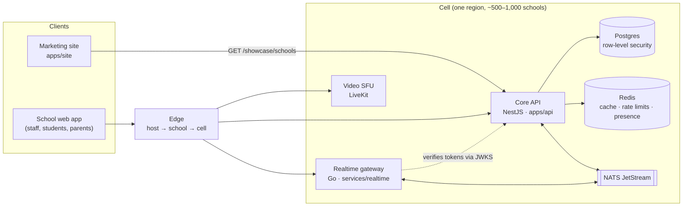

# Dopple

A multi-tenant school management platform. Every school gets its own address, its own data boundary and its own bank account for fees, on shared infrastructure.

Each school (a **tenant**) gets:

- a **web app** at `<slug>.dopple.school` (or its own domain) for admins, teachers, students and parents, each seeing their own screens,
- live video classes, a shared whiteboard, a recorded lesson library, computer-based exams, ID cards, bus tracking, events, attendance, grades and fee payments that settle straight to the school.

> **New here, person or AI agent?** Read [`AGENTS.md`](AGENTS.md) (rules) and then [`docs/context/CONTEXT.md`](docs/context/CONTEXT.md) (where the work stands).

## Contents

- [Status](#status)
- [Architecture](#architecture)
- [Repository layout](#repository-layout)
- [Getting started](#getting-started)
- [Configuration](#configuration)
- [API](#api)
- [Testing](#testing)
- [Observability](#observability)
- [Contributing](#contributing)
- [Documentation](#documentation)

## Status

| Part | Path | State |
| --- | --- | --- |
| Core API | `apps/api` | Running: tenancy, row-level security, auth, observability, school records (students, classes, enrolments, timetable) |
| Marketing site | `apps/site` | Built (v1) |
| School web app (staff, students, parents) | `apps/web` | Built (v1): sign-in, students and guardians, classes, timetables, fees, parent view. No desktop app ([ADR 0007](docs/decisions/0007-web-only.md)) |
| Realtime gateway | `services/realtime` | Planned |
| Local infrastructure | `infra` | Ready |

What's next is tracked in [`docs/context/CONTEXT.md`](docs/context/CONTEXT.md#next-up). Announced "coming soon" features are in [`docs/roadmap.md`](docs/roadmap.md).

## Architecture



Today `apps/api`, `apps/site` and Postgres are built; the rest of the diagram is the target design. The full overview, with more diagrams, is the [architecture doc](https://claude.ai/code/artifact/bd7488b4-c632-49d5-aae1-6a5e88965ff9). There is a one-page summary in [`docs/architecture.md`](docs/architecture.md).

### Key ideas

- **Cells.** The platform runs as complete copies of the stack, each serving a bounded number of schools. A failure or bad deploy stays inside one cell.
- **Tenancy tiers.** Pooled (shared database, row-level security) → bridged (own database) → silo (own cell and keys). The same code runs in every tier.
- **Load follows the school bell.** Traffic spikes when classes start, so capacity is scaled ahead of time from timetables.
- **Real-time traffic skips the API.** Video goes through LiveKit. The whiteboard (Yjs CRDT), chat and presence go through the Go gateway and NATS.
- **Money never touches Dopple.** Fees settle to each school's own account through payment-provider subaccounts, with a per-school ledger reconciled daily.

### Request path (today)

1. **Host → school.** `TenantMiddleware` reads the `Host` header (`greenfield.dopple.localhost`), resolves the school from the `tenants` registry (cached briefly) and stores it in request context. Unknown hosts get `404`. The school is **never** taken from the body, query or custom headers.
2. **Token → user.** A global `AuthGuard` requires `Authorization: Bearer <token>` on every route except those marked `@Public()`. The token's school (`tid` claim) must match the school from the host, so a valid token from one school is rejected at another. `@Roles()` limits a route to certain roles.
3. **Query → rows of this school only.** Services read and write through `TenantDb.run()`. It opens a transaction and sets `app.tenant_id`, and Postgres row-level security then filters every query to that school. The API connects as `dopple_app`, which is not a superuser and does not own the tables, so the policies always apply.

### Authentication

Accounts belong to one school; the same email at two schools is two separate accounts. See [ADR 0004](docs/decisions/0004-authentication.md).

| Piece | Choice |
| --- | --- |
| Passwords | scrypt (`node:crypto`), cost parameters stored in the hash |
| Access tokens | JWT, Ed25519 (`jose`), 15 minutes, claims `sub`, `tid`, `role` |
| Verification by other services | Public key at `/.well-known/jwks.json` |
| Refresh tokens | Opaque, stored as SHA-256, 30 days, single use. Reusing one ends all of that user's sessions |
| Browser sessions | With `X-Dopple-Session: cookie`, the refresh token is an HttpOnly `__Host-` cookie, never in the body ([ADR 0008](docs/decisions/0008-browser-sessions.md)) |
| Brute-force protection | Per-IP limit on sign-in (10/min) and refresh (30/min), in memory for now |

### Tech stack

| Area | Choice |
| --- | --- |
| Core API | TypeScript, NestJS 12 (ESM), modular monolith |
| Database | Postgres 17, Drizzle ORM, row-level security |
| Validation | zod (environment and request bodies) |
| Realtime | Go WebSocket gateway, NATS JetStream (planned) |
| Video | LiveKit (planned) |
| Cache | Redis |
| School web app | Vite, React 19, React Router, TanStack Query, Tailwind CSS 4; one app for every role ([ADR 0009](docs/decisions/0009-web-app-stack.md)) |
| Marketing site | Next.js 16 (Cache Components), Tailwind CSS 4 |
| Observability | OpenTelemetry → Grafana LGTM (Tempo, Prometheus, Loki) |
| Tooling | pnpm workspaces, Vitest, Playwright, oxlint, Prettier |

The reasons for each choice are in [ADR 0001](docs/decisions/0001-tech-stack.md).

## Repository layout

```text
dopple/
├── apps/
│   ├── api/                  NestJS API
│   │   ├── src/
│   │   │   ├── config/       zod-validated environment (env.ts)
│   │   │   ├── tenancy/      host → school resolution, TenantMiddleware
│   │   │   ├── database/     Drizzle schema, RLS policies, TenantDb
│   │   │   ├── modules/      one folder per feature (auth, classes, students, …)
│   │   │   ├── observability/ OpenTelemetry setup, logger, business metrics
│   │   │   └── health/       /health/live, /health/ready
│   │   ├── drizzle/          SQL migrations (never edit an applied one)
│   │   ├── scripts/seed.mjs  demo schools and users
│   │   └── test/             e2e tests, including tenant isolation
│   ├── site/                 marketing website (copy in src/lib/content.ts)
│   └── web/                  school web app: sign-in, records, timetables (src/lib: API client, session, data hooks)
├── services/realtime/        Go WebSocket gateway (planned)
├── infra/                    docker-compose: Postgres, Redis, NATS, Grafana
├── docs/
│   ├── architecture.md       one-page architecture summary
│   ├── decisions/            architecture decision records (ADRs)
│   ├── context/CONTEXT.md    living handover note: done, next, open questions
│   └── roadmap.md            features announced as coming soon
├── scripts/                  start-dopple.command (macOS one-click start)
└── .github/                  CI, PR template, UI-evidence check
```

## Getting started

### Requirements

- Node.js **22.22+** (see `.nvmrc`)
- pnpm via corepack: `corepack enable`
- **Either** Docker (recommended) **or**, on macOS, Homebrew

### Option A: Docker

```bash
pnpm install
pnpm infra:up                          # Postgres, Redis, NATS, Grafana
cp apps/api/.env.example apps/api/.env
pnpm db:migrate                        # runs as the owner role
pnpm db:seed                           # demo schools: greenfield, riverside
pnpm dev                               # API on http://localhost:3000 (watch mode)
pnpm dev:site                          # website on http://localhost:3100
pnpm dev:web                           # school web app on http://greenfield.dopple.localhost:3200
```

### Option B: macOS without Docker

Double-click `scripts/start-dopple.command`, or run it from a terminal. It installs Node 22 and PostgreSQL 17 with Homebrew if needed, creates the database roles, migrates, seeds, and starts the API on `:3000` and the website on `:3100`. Logs are written to `.run/`.

> The script does not start the school web app yet: run `pnpm dev:web` afterwards.

> The script frees ports 3000 and 3100 before starting, which stops anything else listening there. If another project uses those ports, start Dopple by hand instead with `PORT=3002 pnpm dev` and `DOPPLE_API_URL=http://localhost:3002 pnpm dev:site` (and the same `DOPPLE_API_URL` for `pnpm dev:web`).

### Try it

`*.localhost` resolves to `127.0.0.1`, so each demo school has its own local address. The seed creates a 2026/2027 session with three terms, a few subjects, two JSS 1 classes (students enrolled in JSS 1A, which takes every subject with the demo teacher), and accounts `admin@<slug>.test`, `teacher@<slug>.test`, `student@<slug>.test` and `parent@<slug>.test` (the first student's mother), all with the password `dopple-demo`.

**On the website:** http://localhost:3100/login finds a school and sends you to its sign-in page; http://localhost:3100/start creates a new school.

**In the browser:** with `pnpm dev` and `pnpm dev:web` running, open http://greenfield.dopple.localhost:3200 (or `riverside.`) in Chrome and sign in with one of those accounts. Admins and teachers get Students and Classes; students get their own timetable.

**From a terminal:**

```bash
# Sign in at Greenfield
TOKEN=$(curl -s -H "Host: greenfield.dopple.localhost" -H 'content-type: application/json' \
  -d '{"email":"admin@greenfield.test","password":"dopple-demo"}' \
  localhost:3000/auth/sign-in | node -pe 'JSON.parse(require("fs").readFileSync(0)).accessToken')

# Greenfield's students
curl -H "Host: greenfield.dopple.localhost" -H "Authorization: Bearer $TOKEN" localhost:3000/students

# The same token at Riverside is rejected with 401
curl -H "Host: riverside.dopple.localhost" -H "Authorization: Bearer $TOKEN" localhost:3000/students
```

With no `JWT_PRIVATE_KEY` set, the API generates a throwaway signing key at boot, so tokens stop working after each restart. Sign in again.

## Configuration

API variables are validated at startup in [`apps/api/src/config/env.ts`](apps/api/src/config/env.ts); the app refuses to start if one is invalid. Defaults are in [`apps/api/.env.example`](apps/api/.env.example).

| Variable | Default | Purpose |
| --- | --- | --- |
| `PORT` | `3000` | API port |
| `DATABASE_URL` | — | App role connection (`dopple_app`, **must not** be a superuser) |
| `MIGRATION_DATABASE_URL` | — | Owner role, used only by migrations and the seed |
| `DATABASE_POOL_MAX` | `10` | Connection pool size |
| `PLATFORM_DOMAIN` | `dopple.localhost` | Schools are served at `<slug>.<PLATFORM_DOMAIN>` |
| `TENANT_CACHE_TTL_SECONDS` | `60` | How long a host → school lookup is cached |
| `JWT_PRIVATE_KEY` | empty (throwaway key) | Ed25519 PKCS#8 PEM. **Required in production** |
| `ACCESS_TOKEN_TTL_SECONDS` | `900` | Access-token lifetime |
| `REFRESH_TOKEN_TTL_DAYS` | `30` | Refresh-token lifetime |
| `LOGIN_RATE_LIMIT_PER_MINUTE` | `10` | Sign-in attempts per IP per minute (refresh gets 3×) |
| `SCHOOL_URL_FORMAT` | `https://{host}` | A school's web app address; `{host}` is `<slug>.<PLATFORM_DOMAIN>` or its custom domain. Locally `http://{host}:3200` |
| `SCHOOL_SIGNUPS_PER_HOUR` | `5` | New schools per client IP per hour |
| `PAYMENT_PROVIDER` | `fake` | Who takes fee payments: `fake` (no money; not allowed in production) or `bachs` |
| `BACHS_SECRET_KEY` / `BACHS_WEBHOOK_SECRET` | — | Needed when `PAYMENT_PROVIDER=bachs`. An `sk_sandbox_` key uses the sandbox, `sk_live_` production |
| `LOG_LEVEL` | `info` | pino log level |
| `OTEL_*` | OTLP → `localhost:4318` | Standard OpenTelemetry variables; set exporters to `none` without Grafana |

Website (`apps/site/.env.local`, see `.env.example`):

| Variable | Default | Purpose |
| --- | --- | --- |
| `DOPPLE_API_URL` | `http://localhost:3000` | Where the partner wall reads `/showcase/schools` |
| `SHOWCASE_MIN_SCHOOLS` | `6` | Hide the partner wall until this many schools opt in |
| `PLATFORM_DOMAIN` | `dopple.school` | Shown after the address on the sign-up form (`greenfield.<this>`); the real address comes from the API |

## API

The school is always taken from the `Host` header. Platform routes are served without a school host.

| Method | Path | Access | Purpose |
| --- | --- | --- | --- |
| `GET` | `/health/live` | public, platform | The process is up |
| `GET` | `/health/ready` | public, platform | The database is reachable |
| `GET` | `/showcase/schools` | public, platform | Schools that opted in to the website's partner wall |
| `GET` | `/.well-known/jwks.json` | public, platform | Public key for verifying access tokens |
| `GET` | `/schools?q=` | public, platform | Find a school by part of its name or address (2+ characters, at most 8 results), with its sign-in URL |
| `GET` | `/schools/availability?slug=` | public, platform | Whether an address is free, and why not |
| `POST` | `/schools` | public, platform | Self-serve sign-up: a new school and its first admin (rate-limited) |
| `GET` / `PATCH` | `/school` | read: public · write: admin | The school at this address: name, colour, logo URL. Admins change `name` and `brandColor` |
| `GET` / `PUT` / `DELETE` | `/school/logo` | read: public · write: admin | The school's logo; upload the image itself as the body (PNG, JPEG or WebP, up to 200 KB) |
| `POST` | `/auth/sign-in` | public, school | `{ email, password }` → access and refresh tokens (rate-limited). With `X-Dopple-Session: cookie` the refresh token is set as a cookie instead |
| `POST` | `/auth/refresh` | public, school | `{ refreshToken }`, or the cookie with `X-Dopple-Session: cookie` → new token pair (rate-limited) |
| `POST` | `/auth/sign-out` | public, school | `{ refreshToken }` or the cookie → ends that session and clears the cookie |
| `GET` | `/auth/me` | signed in | The current user |
| `GET` / `POST` | `/students` | read: admin, teacher · write: admin | Students; search names and admission numbers with `?q=` |
| `GET` / `PATCH` | `/students/:id` | read: admin, teacher · write: admin | One student's admission record (ADR 0016) with their class per session and health; edit any field: names, `sex`, `dateOfBirth`, `admittedOn`, `nationality`, `stateOfOrigin`, `lga`, `homeAddress`, `previousSchool`, `religion`, `userId` |
| `PUT` | `/students/:id/health` | admin | Replace the health record `{ bloodGroup, genotype, allergies, conditions }` (all optional) |
| `GET` / `PUT` / `DELETE` | `/students/:id/photo` | read: staff, the student, their parents · write: admin | The passport photo; upload the image itself as the body (PNG, JPEG or WebP, up to 200 KB) |
| `GET` / `POST` | `/students/:id/guardians` | read: admin, teacher · write: admin | The student's parents and guardians; add `{ relationship, name, phone, email?, userId? }` or link one on record `{ relationship, guardianId }` (ADR 0015) |
| `DELETE` | `/students/:id/guardians/:guardianId` | admin | Unlink; a guardian with no children left is removed |
| `GET` | `/guardians?q=` | admin | Guardians by name or phone, with their children (for linking siblings) |
| `PATCH` | `/guardians/:id` | admin | Edit `name`, `phone`, `email`, or `userId` (a parent account) |
| `GET` | `/children` | parent | My children, with their class in the latest session |
| `GET` | `/children/:id` | parent | My child's whole record as the school holds it, with consents and the consent wording (ADR 0017) |
| `PUT` | `/students/:id/consents/:purpose` | admin | Record a signed paper answer `{ guardianId, given }` for `record`, `health` or `photo`; a no to health or photo erases it |
| `PUT` | `/children/:id/consents/:purpose` | parent | Answer for my child online `{ given }` |
| `GET` / `POST` | `/children/:id/corrections` | parent | My correction requests; ask for one `{ changes: { field: value }, note? }` |
| `GET` | `/corrections?studentId=` | admin | Open correction requests, with what the record holds now |
| `POST` | `/corrections/:id/apply` · `/corrections/:id/decline` | admin | Apply the changes, or decline with `{ reply }` |
| `GET` / `POST` | `/sessions` | read: signed in · write: admin | School years with their terms |
| `GET` / `POST` | `/subjects` | read: signed in · write: admin | Subjects and their codes |
| `GET` / `POST` | `/classes` | read: signed in · write: admin | Class groups; filter with `?sessionId=` |
| `GET` / `PATCH` | `/classes/:id` | read: signed in · write: admin | One class, including its form teacher |
| `GET` | `/classes/:id/students` | admin, teacher | Students enrolled in the class |
| `PUT` / `DELETE` | `/classes/:id/students/:studentId` | admin | Enrol (moves the student if already in another class that session) or remove |
| `GET` | `/classes/:id/subjects` | signed in | The class's subjects and their teachers |
| `PUT` / `DELETE` | `/classes/:id/subjects/:subjectId` | admin | Add a subject, set its teacher (`{ teacherId }`; 409 if they're busy during its periods), or remove it |
| `GET` / `POST` | `/classes/:id/timetable` | read: signed in · write: admin | Weekly periods for `?termId=`; refuses overlaps and teacher double-booking (409) |
| `DELETE` | `/classes/:id/timetable/:slotId` | admin | Remove a period |
| `GET` | `/timetable/me` | admin, teacher, student, parent | `?termId=`: the lessons I teach, or my class's timetable; parents add `&studentId=` |
| `GET` / `POST` | `/fees/account` | admin | The school's own account with the payment provider; `POST` sets it up (ADR 0013) |
| `GET` / `POST` | `/fees` | admin | All fees with what is paid (`?studentId=`); bill `{ description, amountMinor, dueOn?, studentIds \| classId }` (kobo) |
| `DELETE` | `/fees/:id` | admin | Delete a fee nobody has tried to pay (409 otherwise) |
| `GET` | `/fees/me` | student, parent | My fees, or my children's |
| `POST` | `/fees/:id/pay` | student, parent | Start paying what is left; returns the provider's payment page `{ url }` |
| `POST` | `/payments/webhooks/:provider` | public, signed | Payment events from the provider (verified by its adapter, counted once per event id) |

## Testing

```bash
pnpm check        # lint + typecheck + unit tests + build, all workspaces. Run before every PR.
pnpm test:e2e     # API e2e tests, site smoke tests and web app tests (need a migrated, seeded database and a running API)
```

- **Tenant isolation** ([`apps/api/test/tenant-isolation.e2e-spec.ts`](apps/api/test/tenant-isolation.e2e-spec.ts)) is the most important test in the repo. It proves that one school never sees another's rows, tokens or sessions. Any change that touches tenancy must extend it.
- **Web app tests** use Playwright against the running API and the seeded Greenfield school. They sign in as admin, student and teacher; add and edit a student; add a lesson, are refused an overlapping one, and remove it; check that a reload keeps the session through the HttpOnly cookie; and check phone width.
- **Site smoke tests** use Playwright on desktop and mobile. They check that the page renders, logs no console errors, has no sideways scroll, and that the FAQ works. Set `CHROMIUM_PATH` to reuse an installed Chromium.

## Observability

OpenTelemetry starts before the app (`node --import ./dist/instrumentation.js`). It traces HTTP, Express and Postgres automatically. Logs are pino JSON that include `trace_id`, so you can jump from a log line to its trace. Every span and request log carries the school (`tenant.id`, `tenant.slug`). Business metrics (sign-ins, refresh-token reuse, tenant requests, fee payments received) live in `apps/api/src/observability/metrics.ts`.

Locally, `pnpm infra:up` runs Grafana at http://localhost:3001 (user `admin`, password `admin`). See [ADR 0003](docs/decisions/0003-observability.md).

## Contributing

The full rules are in [`AGENTS.md`](AGENTS.md). The non-negotiable ones:

- **Tenant isolation.** Every tenant-owned table has `tenant_id` first in its primary key, row-level security, and the `tenantIsolation` policy. Access those tables only through `TenantDb.run()`.
- **Every route is private by default.** Mark public routes with `@Public()` deliberately.
- **Feature modules** live in `apps/api/src/modules/<feature>`, split into controller (HTTP only), service (logic) and spec. ESM imports end in `.js`.
- **Schema changes:** edit `schema.ts`, then run `pnpm --filter @dopple/api db:generate`. Never edit an applied migration.
- **No personal data in logs**, and never `console.log`.
- **Commits:** imperative summary under 72 characters, then why. **No `Co-authored-by` trailers**: a git hook and CI reject them.
- **Pull requests:** one logical change each. Fill in the template, and `pnpm check` must pass. Any PR touching `apps/site`, `apps/web` or `packages/ui` needs **Before and After screenshots of the running UI** from that branch. CI enforces this; mock-ups or AI-generated images don't count.
- **At the end of every session**, update `docs/context/CONTEXT.md`. Record architectural choices as an ADR in `docs/decisions/`.

## Documentation

| Document | What it covers |
| --- | --- |
| [`AGENTS.md`](AGENTS.md) | Rules and commands for anyone changing the code |
| [`docs/context/CONTEXT.md`](docs/context/CONTEXT.md) | Current state, next up, open questions, session log |
| [`docs/architecture.md`](docs/architecture.md) | One-page architecture and how `apps/api` maps to it |
| [`docs/decisions/`](docs/decisions) | ADRs: tech stack, tenant isolation, observability, authentication, school structure, timetable, web only, browser sessions, web app stack, self-serve schools and branding |
| [`docs/roadmap.md`](docs/roadmap.md) | Features announced as coming soon |
| [Architecture overview](https://claude.ai/code/artifact/bd7488b4-c632-49d5-aae1-6a5e88965ff9) | Full design with diagrams |
| [Website and portal designs](https://claude.ai/code/artifact/f45b09ad-3e6b-44ca-8bb6-033d7ca1bcd3) | Design canvas |

## License

No license has been chosen yet. The packages are marked `UNLICENSED`, and the code is not yet offered for reuse.
